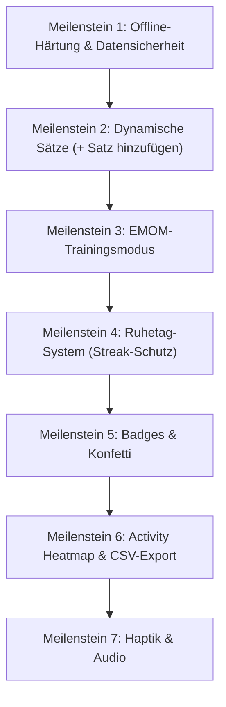

# Push-Up Discipline PWA — Umfassende Entwicklungs-Roadmap & Agenten-Briefing

> **Hinweis für KI-Agenten**: Dieses Dokument dient als verbindliche Spezifikation und Schritt-für-Schritt-Anleitung für die Weiterentwicklung der Push-Up Discipline PWA. Lies dieses Dokument vor Beginn der Arbeiten vollständig durch.

---

## 1. Projekt-Kontext & Ist-Zustand

- **Technologie**: Reines Vanilla JavaScript (ES6+), HTML5, CSS3 (OLED Dark Mode), Service Worker ([sw.js](file:///Users/jonahsimon/IdeaProjects/PUSH-UPPWA/sw.js)), IndexedDB mit localStorage-Fallback ([app.js](file:///Users/jonahsimon/IdeaProjects/PUSH-UPPWA/app.js)).
- **Abhängigkeiten**: Bislang nur Chart.js v4.4.4 über CDN ([index.html](file:///Users/jonahsimon/IdeaProjects/PUSH-UPPWA/index.html)).
- **Ziel-Plattform**: iOS Standalone PWA (iPhone) & Desktop Browser.
- **Aktuelle Kernlogik**:
  - Zwei Sessions pro Tag: Morgen & Abend (bislang starr je 3 Sätze).
  - Midnight-Grace-Period: 00:00–03:00 Uhr zählt zum Vorabend.
  - Kalender/History-Ansicht mit nachträglichem Editieren.
  - Analytics (7T, 30T, 90T, Gesamt) & Records.
  - JSON Export/Import.

---

## 2. Datenbankschema-Erweiterung (IndexedDB & LocalStorage)

In [docs/ARCHITECTURE.md](file:///Users/jonahsimon/IdeaProjects/PUSH-UPPWA/docs/ARCHITECTURE.md) und [app.js](file:///Users/jonahsimon/IdeaProjects/PUSH-UPPWA/app.js) muss das Schema von fixen 3 Sätzen auf dynamische Arrays erweitert werden:

```typescript
type DateString = string; // YYYY-MM-DD
type ISO8601String = string;

interface Set {
  reps: number;
  timestamp: ISO8601String | null;
}

interface Session {
  sets: Set[]; // Dynamisch: Mindestens 1 Satz, beliebig viele erweiterbar (+ Button)
  completed: boolean;
}

interface EmomSession {
  targetRepsPerMinute: number;
  completedRounds: number;
  totalReps: number; // completedRounds * targetRepsPerMinute
  failedRoundReps: 0; // Abgebrochene / nicht geschaffte Runde zählt exakt 0
  timestamp: ISO8601String;
}

interface DayRecord {
  date: DateString;
  morning: Session;
  evening: Session;
  emom?: EmomSession[]; // Array aller am Tag absolvierten EMOM-Sessions
  isRestDay?: boolean; // Kennzeichnung als Ruhetag (Streak-Schutz)
  notes: string;
}

interface StreakMetadata {
  key: "streak_metadata";
  currentStreak: number;
  longestStreak: number;
  lastCompletedDate: DateString | null;
  lastRestDate?: DateString | null; // Datum des letzten genutzten Ruhetags
}
```

---

## 3. Die 7 Meilensteine im Detail



---

### Meilenstein 1: Offline-Härtung & Datensicherheit
1. **Chart.js lokal einbinden**:
   - Chart.js 4.4.4 lokal im Verzeichnis `vendor/chart.umd.min.js` ablegen.
   - [index.html](file:///Users/jonahsimon/IdeaProjects/PUSH-UPPWA/index.html): CDN-Link ersetzen durch `<script src="vendor/chart.umd.min.js"></script>`.
   - [sw.js](file:///Users/jonahsimon/IdeaProjects/PUSH-UPPWA/sw.js): CDN-URL aus Cache entfernen, `CACHE_NAME` auf `pushup-v3` erhöhen, `./vendor/chart.umd.min.js` sowie die Icons in `ASSETS_TO_CACHE` aufnehmen.
2. **Persistent Storage API**:
   - In `DB.init()` in [app.js](file:///Users/jonahsimon/IdeaProjects/PUSH-UPPWA/app.js) prüfen und aufrufen:
     ```javascript
     if (navigator.storage && navigator.storage.persist) {
       navigator.storage.persist().then(persistent => {
         console.log('Storage persistent:', persistent);
       });
     }
     ```
   - Schützt Safari-IndexedDB vor automatischer Speicherbereinigung.

---

### Meilenstein 2: Dynamische Sätze (+ Satz hinzufügen)
1. **UI Heute-Ansicht**:
   - In der Morgen- und Abend-Karte unter den vorhandenen Sätzen einen Button `+ Satz hinzufügen` einbauen.
   - Beim Klick wird ein neuer Satz (Satz 4, 5, etc.) dynamisch hinzugefügt.
   - Stepper-Logik (`-5`, `-1`, Input, `+1`, `+5`) für alle Sätze modular binden.
   - Ein kleiner Lösch-Button `✕` neben zusätzlichen Sätzen (> Satz 3), um versehentlich hinzugefügte Sätze zu entfernen.
2. **Dynamische Summenberechnung**:
   - `total-morning`, `total-evening` und `total-daily` summieren dynamisch alle vorhandenen Sätze auf.
3. **Retroactive Edit (Kalender)**:
   - Auch beim Bearbeiten vergangener Tage im Kalender müssen Sätze flexibel hinzugefügt oder entfernt werden können.
4. **Abwärtskompatibilität**:
   - Vorhandene Tage mit 3 Sätzen werden nahtlos geladen.

---

### Meilenstein 3: EMOM-Trainingsmodus (Every Minute On the Minute)
1. **Neuer Navigationstab**:
   - Ergänzung der Bottom-Navigation in [index.html](file:///Users/jonahsimon/IdeaProjects/PUSH-UPPWA/index.html): Tab "EMOM" (Icon ⏱️).
2. **Setup-Ansicht**:
   - Einstellung: Wiederholungen pro Minute (z. B. Stepper mit 5, 10, 15, 20 oder Freitext).
   - Start-Button.
3. **Aktives Workout**:
   - **60-Sekunden-Timer**: Visueller Kreisbalken oder Fortschrittsbalken, der jede Minute von 60 auf 0 läuft.
   - **Rundenzähler**: "Runde X".
   - **Button "Runde geschafft"**: Quittiert die Runde. Die restlichen Sekunden der Minute sind automatische Pause.
   - **Button "Workout beenden / Abbrechen"**:
     - **Regel**: Alle **abgeschlossenen** Runden zählen voll (`Runden × Reps`).
     - Die angebrochene/letzte Runde, in der man abbricht, zählt **0**.
4. **Datenanrechnung & Records**:
   - Die erreichten EMOM-Wiederholungen fließen direkt in das Tages-Gesamttotal (`total-daily`) ein.
   - In den Statistiken ([view-stats](file:///Users/jonahsimon/IdeaProjects/PUSH-UPPWA/index.html#L177)): Neuer Personal Record **"Bestes EMOM"** (Rundenanzahl & Reps).
5. **Screen Wake-Lock**:
   - `navigator.wakeLock.request('screen')` während des EMOM-Workouts aktiv halten, damit das Display nicht sperrt.

---

### Meilenstein 4: Ruhetag-System (Streak-Schutz)
1. **Regel**:
   - Maximal **1 Ruhetag pro rollierendem 7-Tage-Fenster**.
   - An diesem Ruhetag bricht der Streak bei 0 Reps **nicht** ab.
2. **UI**:
   - Button auf der Heute-Seite oder im Kalender: *"Heute als Ruhetag markieren"*.
   - Kann nur aktiviert werden, wenn in den letzten 6 Tagen kein Ruhetag genutzt wurde.
3. **Streak-Engine**:
   - [Streak.calculate](file:///Users/jonahsimon/IdeaProjects/PUSH-UPPWA/app.js#L325-L374) anpassen: Tage mit `isRestDay: true` überbrücken die Streak-Kette, sofern die 1-Tag-pro-Woche-Regel eingehalten wird.
4. **Kalender-UI**:
   - Ruhetage erhalten ein eigenes Icon/Farbe (z. B. blaues Schild 🛡️ oder Pause ☕).

---

### Meilenstein 5: Gamification & Badges
1. **Folgende 4 Badges umsetzen**:
   - 🏆 **Century Club**: 100+ Wiederholungen an einem einzelnen Kalendertag.
   - 🛡️ **Iron Consistency**: Streaks von 7, 30 und 100 Tagen.
   - ⚡ **10k Club**: 10.000 Gesamtwiederholungen in der App.
   - 🌅 **Early Bird**: Morgen-Session vor 07:00 Uhr geloggt.
2. **Badge-UI**:
   - Übersichtskarten im Stats-Bereich mit Freischalt-Status und Fortschrittsbalken.
3. **Konfetti-Effekt**:
   - Leichtgewichtige Canvas-Partikel-Animation (reines Vanilla JS, keine Fremdbibliothek).
   - Trigger: Freischaltung eines Badges, neuer PR oder vollständiger Tag.

---

### Meilenstein 6: Analytics & Export (Heatmap & CSV)
1. **GitHub-Style Activity Heatmap**:
   - 52 Wochen × 7 Tage Kachel-Matrix im Stats-Tab.
   - Farbintensität je nach Tages-Wiederholungen.
   - Tooltip bei Klick auf eine Kachel.
2. **CSV/Excel-Export**:
   - Download-Button in den Einstellungen.
   - Format: `Datum, Morgen_Sätze, Morgen_Total, Abend_Sätze, Abend_Total, EMOM_Reps, Tages_Total`.

---

### Meilenstein 7: Haptik & Audio-Feinschliff
1. **Haptik**:
   - `navigator.vibrate([15])` bei Steppern und Klicks.
   - `navigator.vibrate([40, 60, 40])` bei Rundenwechsel im EMOM.
2. **Audio**:
   - Web Audio API (Synthesizer-Beeps ohne MP3s): 3-2-1 Countdown vor neuer Minute und Bestätigungston bei Rundenabschluss.

---

## 4. Richtlinien für den ausführenden Agenten

1. **Kein Framework-Umbau**: Die App bleibt eine schlanke, performante Vanilla JS PWA ohne Build-Tool (Vite/Webpack) und ohne Node-Dependencies.
2. **Schrittweise vorgehen**: Setze Meilenstein für Meilenstein um und teste nach jedem Meilenstein die Funktionalität im Browser.
3. **Dokumentations-Integrität**: Bestehende Kommentare und Struktur beibehalten.
